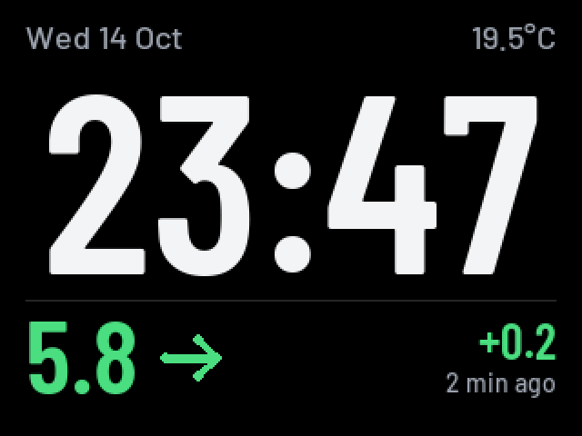
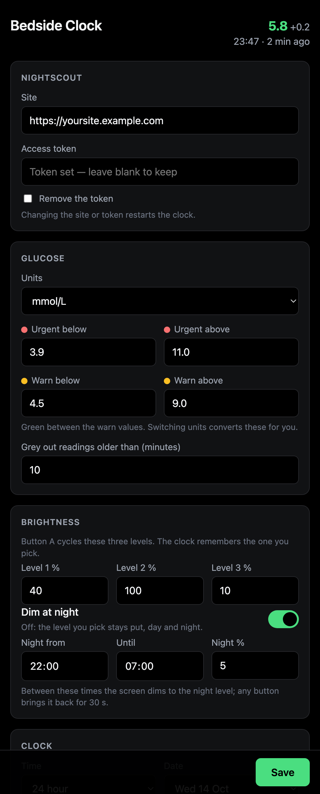

# M5_NightscoutBedside

A calm, readable **bedside clock** for the original **M5Stack Basic Core** that also shows your
latest glucose reading from [Nightscout](https://nightscout.github.io/), with the room temperature
from the sensor in the M5Stack **BTC Standing Base**.

<p align="center"></p>

The time is the biggest thing on the screen, readable from across the room. The glucose reading sits below it,
coloured by your own ranges, and greys out with a strike-through if the data stops coming in. There's no flicker
or busy dashboard. A settings page on your phone and updates over Wi-Fi mean you never have to take the SD
card out or plug in a cable again.

> [!WARNING]
> This is a hobby project and **not a medical device**. Readings can be delayed, missing or wrong. Never use it
> to make treatment decisions, and don't rely on it in place of your CGM app's alerts. It has no sound alarms.

It's a clean rewrite inspired by [mlukasek/M5_NightscoutMon](https://github.com/mlukasek/M5_NightscoutMon) and
reads the same `M5NS.INI` file, so one SD card works with either firmware.

## Screenshots

**The clock in four states:**


*In range, flat · above range (amber), rising · urgent low (red), falling fast · stale data: greyed out and
struck through, with the age in red.*

**Settings page** (on your phone, at `http://m5clock.local`):

<p align="center"></p>

*These are rendered from the firmware's real fonts, layout and settings page (see [Development](#development)),
using made-up example data.*

## Features

- **Big, clear clock** in Barlow Condensed, with the date and room temperature (to 0.1°) above it.
- **Nightscout glucose** with trend arrow, change since the last reading, and how old it is. Fetched every 60 s.
- **Your colours:** green in range, amber and red at the thresholds you choose, in mmol/L or mg/dL.
- **Stale warning:** if no new reading arrives for 10 minutes (adjustable), the value greys out and is struck through.
- **Settings page** in your browser: Nightscout, ranges, brightness, night dimming, time zone, Wi-Fi.
- **Updates over Wi-Fi** from PlatformIO or by uploading a file on the settings page.
- **Optional night dimming** between set hours. Any button brings the brightness back for 30 s.
- **Automatic summer time** (BST/GMT by default) via NTP.
- **Status and log pages** on the device, showing what went wrong overnight (Wi-Fi drops, Nightscout errors, stale data).
- Keeps working through network blips: it shows the last good reading and never reboot-loops.

## What you need

| Part | Notes |
| --- | --- |
| **M5Stack Basic Core** (K001, ESP32, 320×240 screen) | The original Basic/Gray. Other M5Stacks are untested. |
| **M5Stack BTC Standing Base** | Optional. Provides the DHT12 temperature sensor. Without it the temperature is just blank. |
| **microSD card** | Any size, formatted FAT32. Holds the settings file. |
| **USB-A to USB-C cable** | Needed once, for the first flash. **A USB-C to USB-C cable won't work** with the original Basic: its port lacks the resistors that USB-C chargers and computers look for. On a USB-C-only Mac, use a USB-A adapter or hub. |
| A **Nightscout** site | Its address and, if it's locked down, an access token with the `readable` role. |
| A computer with **[PlatformIO](https://platformio.org/)** | `brew install platformio` on macOS, or the VS Code extension. |

## Setup

### 1. Get the code

```bash
git clone https://github.com/gonkowonko/M5_NightscoutBedside.git
cd M5_NightscoutBedside
```

### 2. Prepare the SD card

Copy [`SD/M5NS.INI`](SD/M5NS.INI) to the root of the card, open it in a text editor and fill in at least:

```ini
[config]
; your Nightscout address
nightscout = yoursite.example.com
; your access token (leave empty if your site is public)
token = yourtoken-0123456789abcdef
; 0 = mmol/L, 1 = mg/dL
show_mgdl = 0

[wlan1]
ssid = YourWiFi
pass = YourWiFiPassword
```

Comments (`;` or `#`) must be on their own line. Anything after a value counts as part of the value.

The other settings have sensible defaults, and you can change them all later from the settings page.

> If you already run M5_NightscoutMon, keep your existing `M5NS.INI`, optionally adding a
> `tz = …` line (see [Configuration](#configuration)).

Put the card in the M5Stack.

### 3. Back up the current firmware (optional, recommended)

If the M5Stack already runs something you might want back, save a full copy first. Plug it in with the
USB-A to USB-C cable, then:

```bash
pio pkg exec --package platformio/tool-esptoolpy -- esptool.py --chip esp32 flash_id
```

Note the `Detected flash size` (usually 4MB), then copy the whole chip (`0x400000` for 4 MB, `0x1000000` for 16 MB):

```bash
pio pkg exec --package platformio/tool-esptoolpy -- esptool.py --chip esp32 read_flash 0 0x400000 firmware-backup.bin
```

This file contains your Wi-Fi password and Nightscout token, so keep it private. Git ignores `*-backup.bin`.

### 4. Flash it

With the M5Stack plugged in over USB:

```bash
pio run -t upload
```

This builds the firmware and flashes it, and takes about two minutes. If the port isn't found automatically, run
`ls /dev/cu.*` and add `--upload-port /dev/cu.usbserial-XXXX`. Flashing runs at 115200 baud on purpose,
because faster speeds were unreliable through USB adapters.

### 5. First boot

The clock connects to Wi-Fi, sets the time from the internet, and shows your first reading, all within about
20 seconds. Then:

- Open **http://m5clock.local** on a phone or computer on the same Wi-Fi to reach the settings page. If the
  name doesn't work, press **B** on the clock: the status page shows its IP address.
- Unplug the USB cable. From now on, updates can go over Wi-Fi.

If something's not right, press **B** for the status page and **B** again for the log. Both are described below.

## Using it

| Button | Action |
| --- | --- |
| **A** (left) | Cycle the three brightness levels. The one you pick is remembered across restarts. |
| **B** (middle) | Cycle pages: clock → status → log → clock |
| **C** (right) | Fetch from Nightscout now |

**Night dimming** is off by default. Turn it on with the *Dim at night* switch on the settings page and the screen
dims between the hours you set. A press of any button brings normal brightness back for 30 s. While the screen
is dimmed, that first press only wakes it, so fumbling in the dark doesn't change anything.

**Status page:** Wi-Fi network and signal, IP address, Nightscout site, last fetch time and result, latest
reading, time zone, brightness, sensor (corrected and raw), free memory and uptime.

**Log page:** the last 13 notable events, newest first, so you can see what happened overnight.
Repeats are collapsed (`02:10-02:24 NS HTTP 502 x14`).

| Event | Example |
| --- | --- |
| Boot, and why it restarted | `Boot v1.1.0: brownout (power dip)` |
| Wi-Fi connected / lost | `Wi-Fi: MyHomeWiFi -61 dBm`, `Wi-Fi lost` |
| Nightscout problems and recovery | `NS HTTP 502`, `NS OK again after 3 failures` |
| Data going stale, and why | `Stale: Nightscout has no new data`, `Stale: fetches failing` |
| Time sync, sensor, I2C devices | `Time synced (NTP)`, `Sensor: DHT12 found`, `I2C: 5C 75` |

The log is kept in memory, so it starts fresh after a restart, but the first entry records why the clock restarted.

## Settings page

Everything is editable at **http://m5clock.local**: Nightscout site and token, units, range thresholds, stale
time, brightness levels, night dimming, 12/24-hour time, date format, time zone, temperature correction and Wi-Fi.

- Display changes apply instantly. Changing Nightscout or Wi-Fi saves and restarts the clock.
- The token and Wi-Fi password are never sent to the browser. Leave those fields blank to keep them.
- Saving writes `M5NS.INI` on the SD card, editing only the keys this firmware manages. Settings used by the original
  firmware, and your comments, are left alone. The previous file is kept as `M5NS.PRV`.
- There's **no password**. Anyone on your Wi-Fi can open it, the same as the original firmware's page.

## Updating over Wi-Fi

After the first USB flash, no cable is needed:

```bash
pio run -e ota -t upload       # build and send to m5clock.local
```

You can also upload `.pio/build/m5stack-basic/firmware.bin` in the **Firmware** section of the settings page.

Either way the clock shows a progress bar, checks the new firmware, and only then restarts into it. A failed upload or
a wrong file leaves the current firmware running. The flash is split into two 1.9 MB app slots for this, so
coming from another firmware, the first flash has to be over USB.

## Configuration

All settings live in `M5NS.INI` on the SD card ([example](SD/M5NS.INI)) and can be edited on the settings page.
Read from the original M5_NightscoutMon format:

| Key | Meaning |
| --- | --- |
| `nightscout`, `token` | Nightscout address (host or full URL; `https://` assumed) and access token |
| `show_mgdl` | `0` = mmol/L (one decimal), `1` = mg/dL. Thresholds are in the same unit. |
| `red_low`, `yellow_low`, `yellow_high`, `red_high` | Range colours: red outside `red_*`, amber outside `yellow_*`, green between |
| `brightness1/2/3` | The three brightness levels for button A, in % |
| `time_format` | `0` = 24 h, `1` = 12 h (no AM/PM) |
| `date_format` | `0` = `Wed 14 Oct`, `1` = `Wed Oct 14` |
| `time_zone`, `dst` | Fixed offsets in seconds, used only if `tz` isn't set |
| `[wlan1]` … `[wlan9]` `ssid`, `pass` | Wi-Fi networks (the settings page manages one) |

New in this firmware (ignored by the original):

| Key | Default | Meaning |
| --- | --- | --- |
| `tz` | `GMT0BST,M3.5.0/1,M10.5.0` | [POSIX time zone](https://www.gnu.org/software/libc/manual/html_node/TZ-Variable.html), so summer time switches automatically. Presets on the settings page. |
| `stale_minutes` | `10` | Readings older than this are shown as stale |
| `temp_offset` | `0` | Added to the temperature sensor reading, in °C (e.g. `-3` if it reads high) |
| `night_mode` | `0` | `1` turns night dimming on |
| `night_start`, `night_end` | `22:00`, `07:00` | Night dimming hours (local time) |
| `night_brightness` | `5` | Brightness during the night, in % (`0` = backlight off) |

Unknown keys are ignored, so the original firmware's sound, LED and page settings can stay in the file.

## Going back to M5_NightscoutMon

If you took a backup in step 3, plug in over USB and run:

```bash
pio pkg exec --package platformio/tool-esptoolpy -- esptool.py --chip esp32 write_flash 0 firmware-backup.bin
```

Without a backup, flash the original release: M5Burner on Windows, or the
[`Binaries/BASIC_Gray_Fire`](https://github.com/mlukasek/M5_NightscoutMon/tree/master/Binaries/BASIC_Gray_Fire)
files on any OS. From inside that folder:

```bash
pio pkg exec --package platformio/tool-esptoolpy -- esptool.py --chip esp32 write_flash 0x1000 bootloader_0x1000.bin 0x8000 M5_NightscoutMon.ino.partitions.bin 0xe000 ~/.platformio/packages/framework-arduinoespressif32/tools/partitions/boot_app0.bin 0x10000 M5_NightscoutMon.ino.bin
```

The SD card doesn't need changing.

## Troubleshooting

| Problem | Fix |
| --- | --- |
| Mac doesn't see the M5Stack (`ls /dev/cu.*` shows nothing new) | Use a USB-A to USB-C data cable (see [What you need](#what-you-need)). |
| `Invalid head of packet` / flashing fails part-way | Use the default 115200 baud; avoid long cables and hubs. |
| `No SD card` or `M5NS.INI not found` on screen | Card must be FAT32 with `M5NS.INI` in the root. |
| Clock shows `--:--` | No internet yet: check Wi-Fi on the status page. |
| `---` instead of a reading | Check *Result* on the status page: `HTTP 401` means a wrong or missing token. |
| No temperature | The DHT12 is in the stand. The log's `I2C:` line should list `5C`. |
| Temperature reads high | The sensor sits under the warm M5Stack. Set a temperature correction on the settings page. |
| `m5clock.local` is slow or doesn't open | Use the IP address from the status page. Some apps wait ~5 s for an IPv6 answer first. |

## Development

```
src/main.cpp         glue: setup, buttons, brightness, builds the ScreenModel
src/config.cpp       M5NS.INI reading and writing               (include/config.h, initext.h)
src/network.cpp      background task: Wi-Fi, NTP, mDNS, 60 s fetch (include/network.h)
src/nightscout.cpp   HTTPS request + JSON parsing                (include/nightscout.h)
src/display.cpp      flicker-free clock, status/log/progress screens (include/display.h)
src/webconfig.cpp    settings page + JSON API                    (include/webconfig.h, webpage.h)
src/ota.cpp          firmware updates over Wi-Fi                 (include/ota.h)
src/eventlog.cpp     in-memory event log                         (include/eventlog.h)
src/sensor.cpp       DHT12 over I2C                              (include/sensor.h)
src/timekeeping.cpp  TZ/NTP and clock/date formatting            (include/timekeeping.h)
include/glucose.h    units, range classification, trend parsing
tools/               font generator, screen preview, settings screenshot
test/host/           host-side test of the INI editor
```

Some design notes:

- **No PSRAM on the Basic**, so there's no full-screen buffer. Each screen region is drawn into one reused
  292×32 sprite band and pushed in one go, which avoids flicker. Only regions that changed are redrawn.
- **Fonts** are anti-aliased `.vlw` files in [`fonts/`](fonts), embedded in the firmware with
  `board_build.embed_files` and read straight from flash, so they use no RAM and change with a normal update.
- **Network** (Wi-Fi, NTP, HTTPS) runs in its own FreeRTOS task, so the clock and buttons never wait on it.
  Wi-Fi power saving is off, because the clock is always on USB power.
- Sound alarms aren't implemented. They would hook in where `main.cpp` builds the screen model, using
  `classify()` from `glucose.h`.

Regenerating assets (fonts, screen previews and the settings-page screenshot):

```bash
python3 -m venv tools/.venv && tools/.venv/bin/pip install pillow
tools/.venv/bin/python tools/make_fonts.py     # fonts/*.vlw from the Barlow TTFs (then rebuild)
tools/.venv/bin/python tools/preview.py        # docs/preview.png, docs/clock.png
python3 tools/settings_screenshot.py           # docs/settings.png (needs Google Chrome)
```

`make_fonts.py` picks the largest clock size where `HH:MM` still fits the 292 px width. That's 140 px, with digits
about 100 px tall.

Host test for the INI editor (keeps every unmanaged line, line endings and comments intact):

```bash
clang++ -std=c++17 -I test/host -I include test/host/test_initext.cpp -o /tmp/initext && /tmp/initext SD/M5NS.INI
```

## Credits and licence

- Based on ideas, the INI format and code from [M5_NightscoutMon](https://github.com/mlukasek/M5_NightscoutMon)
  by Martin Lukasek (GPL-3.0), including its `IniFile` (originally by Steve Marple) and DHT12 reading code (by Bobadas).
- [Barlow](https://github.com/jpt/barlow) typeface by Jeremy Tribby, SIL Open Font License 1.1.
- Built on [M5Unified](https://github.com/m5stack/M5Unified), [M5GFX](https://github.com/m5stack/M5GFX) and
  [ArduinoJson](https://arduinojson.org/).

Copyright (C) 2026 Gary Dalley. Licensed under the GNU General Public License v3.0. See [LICENSE](LICENSE).
