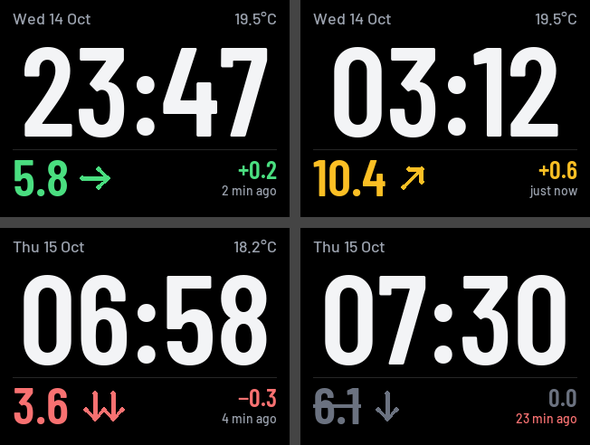

# M5 Bedside Clock

A calm, readable bedside clock for the original **M5Stack Basic Core** (K001) that also shows
your latest glucose reading from [Nightscout](https://nightscout.github.io/), plus the room
temperature from the DHT12 sensor in the **BTC Standing Base**.



*In range · amber with rising arrow · urgent low falling fast · stale data (struck through, age in red).
Rendered by `tools/preview.py` from the same fonts and layout constants as the firmware.*

It's a clean rewrite inspired by
[mlukasek/M5_NightscoutMon](https://github.com/mlukasek/M5_NightscoutMon) and reads the same
`M5NS.INI`, so one SD card works with either firmware.

## What it shows

| Area | Content |
| --- | --- |
| Top line | Date (`Wed 14 Oct`) on the left, room temperature (`19°C`) on the right; blank if no sensor |
| Middle | The time, `HH:MM`, as large as fits. `--:--` until NTP has synced |
| Bottom strip | Glucose value, trend arrow, delta (`+0.2`), and `just now` / `N min ago` |

Colours follow your INI thresholds: green in range, amber outside `yellow_low`/`yellow_high`,
red outside `red_low`/`red_high`. When the newest reading is older than `stale_minutes`
the value, arrow and delta turn grey, the value is struck through and the age turns red.
Before the first reading it shows `---`.

The screen only redraws regions that change (clock and age once a minute, the strip on new
data). Each region is drawn off-screen in a small sprite band and pushed in one go, so there is no flicker.

## Buttons

| Button | Action |
| --- | --- |
| A (left) | Cycle brightness `brightness1` → `brightness2` → `brightness3` |
| B (middle) | Cycle pages: clock → status → log → clock |
| C (right) | Fetch from Nightscout now |

The level you pick with A is remembered across restarts.

Night dimming is opt-in (`night_mode = 1`, or the switch on the settings page). When it's on, the screen dims
to `night_brightness` between `night_start` and `night_end`. A press of any button brings normal brightness
back for 30 seconds. While the screen is dimmed, that first press only wakes it, so fumbling in the dark
doesn't change settings. When it's off, the brightness you picked stays put day and night.

## Settings page

Open **http://m5clock.local** on a phone or computer on the same Wi-Fi. If that name doesn't
resolve, use the IP address on the clock's status page (button B). There's no password: anyone on
your network can open it, the same as the original firmware's web page.

You can change all of these there: Nightscout site and token, units and
range thresholds, stale time, the three brightness levels, night dimming on/off and its times, 12/24 h and date
format, time zone, and the Wi-Fi network. Passwords and the token are never sent to the page;
leave a field blank to keep the current value.

Saving writes `M5NS.INI` on the SD card. Only the keys this firmware manages are edited in place,
so the original firmware's settings and your comments are left as they are. The previous file is
kept as `M5NS.PRV`. Display settings apply immediately. Changing the Nightscout site, token or
Wi-Fi restarts the clock.

## Status and log pages

**Status** shows the current state: Wi-Fi network and signal, IP, Nightscout URL, last fetch
time and result, latest reading, time sync and TZ, brightness, sensor, fonts loaded, memory
and uptime.

**Log** lists the last 13 notable events, newest first, so you can see *why* the clock was
stale overnight. Repeats are collapsed, e.g. `02:10-02:24 NS HTTP 502 x14`.

| Event | Example |
| --- | --- |
| Boot, with the reason for the restart | `Boot v1.0.0: brownout (power dip)` |
| Wi-Fi connected / lost / not found | `Wi-Fi: HomeNet -61 dBm`, `Wi-Fi lost` |
| Nightscout failures and recovery | `NS HTTP 502`, `NS OK again after 3 failures` |
| Data going stale and why | `Stale: Nightscout has no new data`, `Stale: fetches failing` |
| NTP sync, sensor found/lost, missing fonts | `Time synced (NTP)`, `Sensor: DHT12 lost` |

Times are local (`02:10`, or `Tue 02:10` if not today); events before NTP sync show seconds
since boot until the clock is set. The log lives in RAM and starts fresh after a restart,
but the boot entry records why it restarted. Everything is also printed to the serial port.

## Build and flash

Requires [PlatformIO](https://platformio.org/) (`brew install platformio` on macOS).

```bash
pio run                 # build
pio run -e ota -t upload  # build and install over Wi-Fi (m5clock.local)
pio run -t upload       # build and flash over USB
pio device monitor      # serial log over USB, 115200 baud
```

### Updating over Wi-Fi

Once this firmware is on the clock, updates don't need a cable:

- **From PlatformIO:** `pio run -e ota -t upload` sends the build to `m5clock.local` over Wi-Fi.
- **From the settings page:** in the Firmware section, pick `.pio/build/m5stack-basic/firmware.bin` and
  press *Upload and install*.

Either way the clock shows a progress bar, checks the new image, and only then restarts into it. If the
upload fails or the file isn't valid firmware, the current firmware keeps running. There is no password,
the same as the settings page.

The flash is split into two 1.9 MB app slots (`min_spiffs.csv`) so one can be written while the other runs.
Coming from the original firmware, or from builds before 1.1.0, the first flash has to be over USB so the new
layout is written.

PlatformIO normally finds the serial port on its own. If it doesn't, add `--upload-port /dev/cu.usbserial-XXXX`.
Flashing runs at 115200 baud, because faster speeds were unreliable through a USB-C-to-A adapter.

**USB cable:** the original Basic's USB-C port only works with a **USB-A to USB-C** cable. A USB-C to USB-C
cable doesn't power it up or connect, so on a Mac with only USB-C ports use a USB-A adapter or hub.

## SD card

Copy the contents of the [`SD/`](SD) folder to the root of the microSD card (FAT32):

```
/M5NS.INI          your configuration (edit the example)
/fonts/clock.vlw   Barlow Condensed SemiBold, clock digits
/fonts/bg.vlw      Barlow Condensed SemiBold 58px, glucose value
/fonts/delta.vlw   Barlow Condensed SemiBold 28px, delta
/fonts/text15.vlw  Barlow Medium 15px, date and temperature
/fonts/text14.vlw  Barlow Medium 14px, "N min ago"
```

If you already have a card from M5_NightscoutMon, just add the `fonts` folder (and optionally
the new keys below) to it. If the fonts are missing, the clock falls back to M5GFX's built-in
fonts. It still works, but it's less pretty.

### Configuration (`M5NS.INI`)

Keys read from the original format: `nightscout`, `token`, `time_zone`, `dst`, `show_mgdl`,
`time_format`, `date_format`, `brightness1/2/3`, `yellow_low`, `yellow_high`, `red_low`,
`red_high`, and `ssid`/`pass` in `[wlan1]`…`[wlan9]`. Everything else is ignored.

New optional keys:

| Key | Default | Meaning |
| --- | --- | --- |
| `tz` | `GMT0BST,M3.5.0/1,M10.5.0` | POSIX time zone string; handles BST/GMT automatically. If set, `time_zone`/`dst` are ignored. If neither `tz` nor `time_zone`/`dst` is present, the UK default applies. |
| `stale_minutes` | `10` | Readings older than this are shown as stale |
| `night_mode` | `0` | `1` turns on night dimming; `0` keeps the chosen brightness day and night |
| `night_start` | `22:00` | Start of night dimming (local time) |
| `night_end` | `07:00` | End of night dimming |
| `night_brightness` | `5` | Brightness in percent during the night (0 turns the backlight off) |

Notes:

- `show_mgdl = 0` shows mmol/L (one decimal); `1` shows mg/dL. Thresholds are in the unit you display.
- `nightscout` may be a bare host (`cgm.example.com`) or a full URL; `https://` is assumed.
  The token is appended as `&token=…` and is never shown on screen or in the serial log.
- `time_format = 1` gives a 12-hour clock without AM/PM; `date_format = 1` gives `Wed Oct 14`.
- Data comes from `GET /api/v1/entries/sgv.json?count=2` every 60 s. The delta is the newest
  minus the previous entry, as displayed.

### Regenerating the fonts

The `.vlw` files are generated from the Barlow fonts (SIL Open Font License, see
[`tools/ttf/OFL.txt`](tools/ttf/OFL.txt)):

```bash
python3 -m venv tools/.venv
tools/.venv/bin/pip install pillow
tools/.venv/bin/python tools/make_fonts.py   # writes SD/fonts/*.vlw
tools/.venv/bin/python tools/preview.py      # optional: writes docs/preview.png
```

`make_fonts.py` picks the largest clock size where `HH:MM` still fits the 292px content width.
That's 140px with digits about 100px tall: Barlow Condensed's digits are too wide for 124px-tall digits to fit the width.
Change the sizes or character sets in the `FONTS` table at the top of the script.

## Going back to M5_NightscoutMon

The cleanest way back is a full backup taken **before** the first flash of this firmware:

```bash
pio pkg exec --package platformio/tool-esptoolpy -- esptool.py --chip esp32 read_flash 0 0x400000 nightscoutmon-backup.bin
```

Restore it with:

```bash
pio pkg exec --package platformio/tool-esptoolpy -- esptool.py --chip esp32 write_flash 0 nightscoutmon-backup.bin
```

Without a backup, flash the original release:

- **Windows:** use the M5Burner bundle from the
  [M5_NightscoutMon releases](https://github.com/mlukasek/M5_NightscoutMon/releases).
- **Any OS:** use the binaries in the repo's
  [`Binaries/BASIC_Gray_Fire`](https://github.com/mlukasek/M5_NightscoutMon/tree/master/Binaries/BASIC_Gray_Fire)
  folder. From inside that folder:

  ```bash
  pio pkg exec --package platformio/tool-esptoolpy -- esptool.py --chip esp32 write_flash 0x1000 bootloader_0x1000.bin 0x8000 M5_NightscoutMon.ino.partitions.bin 0xe000 ~/.platformio/packages/framework-arduinoespressif32/tools/partitions/boot_app0.bin 0x10000 M5_NightscoutMon.ino.bin
  ```

The SD card doesn't need changes. The original firmware ignores the new keys and the `fonts` folder.

## Code layout

```
src/main.cpp         glue: setup, buttons, brightness, builds the ScreenModel
src/config.cpp       M5NS.INI parsing                      (include/config.h)
src/network.cpp      background task: Wi-Fi, NTP, 60 s fetch (include/network.h)
src/nightscout.cpp   HTTPS request + JSON parsing           (include/nightscout.h)
src/sensor.cpp       DHT12 over I2C                         (include/sensor.h)
src/display.cpp      layout A rendering, status/log pages   (include/display.h)
src/ota.cpp          firmware updates over Wi-Fi            (include/ota.h)
src/eventlog.cpp     in-memory event log                    (include/eventlog.h)
src/webconfig.cpp    settings web page + JSON API           (include/webconfig.h, webpage.h)
include/initext.h    INI line editor used when saving       (host test: test/host)
src/timekeeping.cpp  TZ/NTP and clock/date formatting       (include/timekeeping.h)
include/glucose.h    units, range classification, trend parsing
tools/               font generator and preview renderer
```

Network I/O runs in its own FreeRTOS task, so the clock and buttons stay responsive while
an HTTPS request is in flight. Any failed fetch keeps the last good reading, and its growing age
eventually shows it as stale. Sound alarms aren't implemented yet. They would hook in where
`main.cpp` builds the screen model, using `classify()` from `glucose.h`.

## Credits and licence

- Based on ideas, the INI format and code from
  [M5_NightscoutMon](https://github.com/mlukasek/M5_NightscoutMon) by Martin Lukasek (GPL-3.0),
  including its `IniFile` (originally by Steve Marple) and DHT12 reading code (by Bobadas).
- [Barlow](https://github.com/jpt/barlow) typeface by Jeremy Tribby, SIL Open Font License 1.1.
- Built on [M5Unified](https://github.com/m5stack/M5Unified), [M5GFX](https://github.com/m5stack/M5GFX)
  and [ArduinoJson](https://arduinojson.org/).

This project is licensed under the GNU General Public License v3.0. See [LICENSE](LICENSE).
